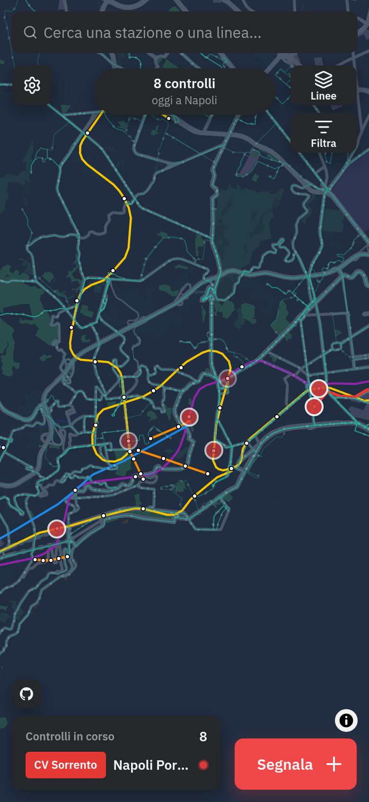
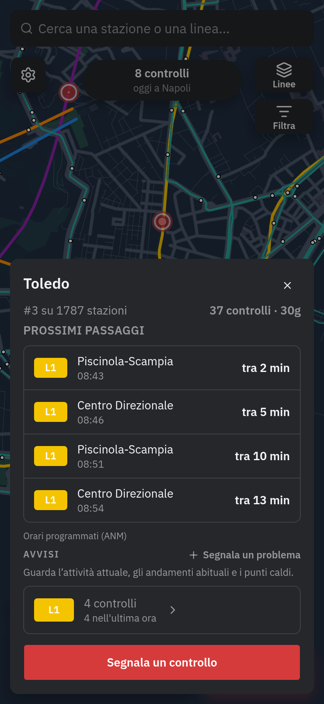
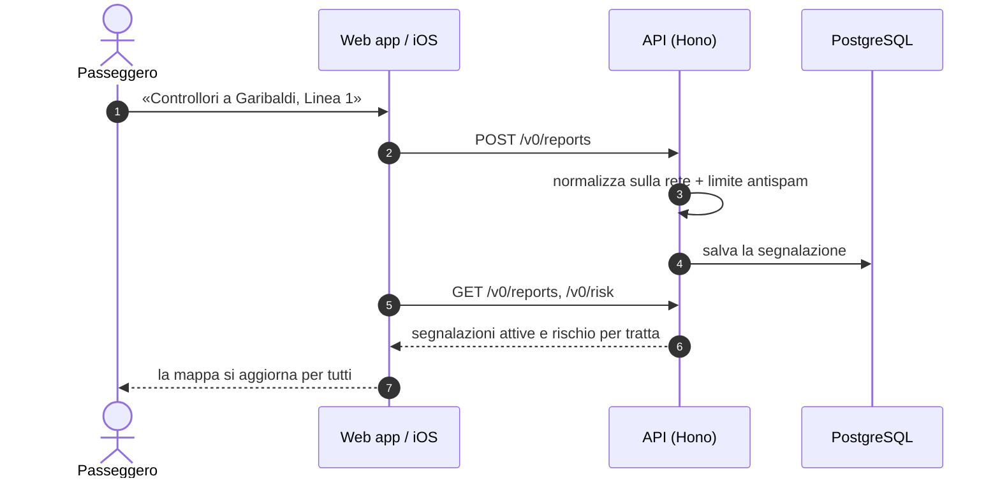
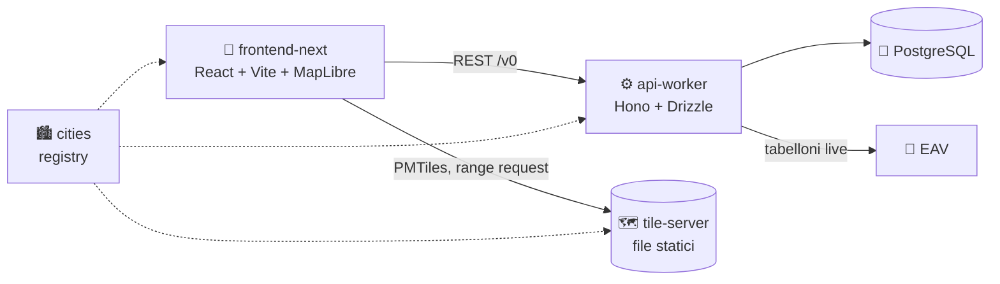

<div align="center">
  <picture>
    <source media="(prefers-color-scheme: dark)" srcset="docs/readme_assets/logo-white.png" />
    
  </picture>

  <h1>Statt’Accuort</h1>

  <p><strong>La mappa live dei controllori sui mezzi pubblici di Napoli.</strong><br/>
  Metro, Cumana, Circumflegrea, Circumvesuviana, funicolari e bus ANM: segnalati dalla community, in tempo reale.</p>

  <p>
    <a href="LICENSE"></a>
    <a href="https://github.com/Giordi9902/StattAccuort/actions/workflows/api-worker-ci.yml"></a>
    <a href="https://github.com/Giordi9902/StattAccuort/actions/workflows/frontend-next-ci.yml"></a>
    <a href="https://github.com/Giordi9902/StattAccuort/actions/workflows/tile-server-ci.yml"></a>
  </p>

  <p>
    
    
    
    
    
    
    
  </p>

  <p>
    <a href="#-avvio-rapido">Avvio rapido</a> ·
    <a href="#-come-funziona">Come funziona</a> ·
    <a href="#%EF%B8%8F-architettura">Architettura</a> ·
    <a href="docs/README.md">Documentazione</a> ·
    <a href="CONTRIBUTING.md">Contribuire</a>
  </p>
</div>

---

<table align="center">
  <tr>
    <td align="center"></td>
    <td align="center"></td>
  </tr>
  <tr>
    <td align="center"><sub><strong>Linee e controlli in corso</strong></sub></td>
    <td align="center"><sub><strong>Scheda stazione e prossimi passaggi</strong></sub></td>
  </tr>
</table>

## 👀 Che cos’è

*Statt’accuort*, in napoletano «stai attento». È una web app (e app iOS) in cui chi viaggia sui
mezzi di Napoli segnala in pochi tocchi dove ha visto i controllori: stazione, linea e direzione.
La segnalazione compare subito sulla mappa di tutti, insieme a una stima del rischio tratta per
tratta, alle statistiche dei punti caldi e ai prossimi passaggi.

## ✨ Funzionalità

| | |
|---|---|
| 🗺️ **Mappa live** | Tutta la rete della città metropolitana su una mappa vettoriale MapLibre, colorata per tipo di linea |
| 📍 **Segnalazioni in tre tocchi** | Stazione, linea, direzione: l’API deduce quello che manca dalla rete |
| 🔥 **Rischio per tratta** | Modello con decadimento spaziale e temporale, combinato con ritardi, disservizi e borseggiatori |
| 🚨 **Avvisi dei passeggeri** | Ritardi (con minuti stimati), disservizi e borseggiatori, a scadenza automatica |
| 🕒 **Prossimi passaggi** | Orari GTFS di ANM e tabelloni EAV in tempo reale |
| 📊 **Insights** | Andamento orario e classifiche delle stazioni e delle linee più controllate |
| 🔒 **Privacy by design** | Nessun account, nessun IP salvato: solo un’impronta anonima HMAC per il limite antispam |
| 📱 **Web, PWA e iOS** | Un solo bundle React servito ovunque, app nativa con Capacitor |
| 🌍 **Pronto per altre città** | Tutto ciò che è specifico di Napoli sta in un registry di dati, non nel codice |

## 🧭 Come funziona



## 🏗️ Architettura

Un monorepo di pacchetti indipendenti e nessun vendor lock-in: un’API Node su PostgreSQL, una web
app statica e una mappa di base in file PMTiles.



| Pacchetto | Cosa fa |
|---|---|
| [`packages/cities`](packages/cities) | Registry delle città: unica fonte di nomi, linee, colori, fuso orario e sorgenti dati |
| [`packages/api-worker`](packages/api-worker) | API REST, pipeline di seed da OpenStreetMap + GTFS, import degli orari, migrazioni |
| [`packages/frontend-next`](packages/frontend-next) | Web app / PWA e app iOS (Capacitor) |
| [`packages/tile-server`](packages/tile-server) | Genera la mappa di base PMTiles da OpenStreetMap |

Tutti i dettagli in [`docs/architecture.md`](docs/architecture.md).

## 🚀 Avvio rapido

Servono **Docker** e, per generare la mappa di base, **Bun**.

```sh
git clone https://github.com/Giordi9902/StattAccuort.git
cd StattAccuort

# 1. Mappa di base (una tantum)
(cd packages/tile-server && bun install && CITY=napoli bun run generate)

# 2. Configurazione
cp .env.example .env                       # imposta POSTGRES_PASSWORD e REPORT_HASH_SECRET

# 3. Database, dati e stack completo
docker compose up -d --build postgres
docker compose run --rm api setup          # seed della rete + orari
docker compose up -d --build
```

Apri **http://localhost:8080** 🎉

<details>
<summary><strong>Sviluppo in locale (API e frontend fuori da Docker)</strong></summary>

```sh
# API → http://localhost:8787
cd packages/api-worker
bun install && cp .env.example .env
bun run db:up                              # PostgreSQL in Docker
bun run seed --city napoli
bun run timetables:import --city napoli
bun run dev

# Frontend → http://napoli.localhost:1871
cd ../frontend-next
bun install && cp .env.example .env        # VITE_API_URL=http://localhost:8787
bun run dev
```

Test dell’API: `bun run test` in `packages/api-worker` (richiede il Postgres locale).
</details>

## 📚 Documentazione

| Documento | Contenuto |
|---|---|
| [Architettura](docs/architecture.md) | Pacchetti, moduli dell’API, pipeline dei dati, osservabilità, scalabilità |
| [Deploy e operazioni](docs/deploy.md) | Docker Compose, configurazione, aggiornamento dei dati, checklist di messa online |
| [API](docs/api.md) | Panoramica degli endpoint REST |
| [Contribuire](CONTRIBUTING.md) | Setup, convenzioni, commit e pull request |
| [Sicurezza](SECURITY.md) | Come segnalare una vulnerabilità |

## 🤝 Contribuire

Bug, nuove linee, traduzioni e pull request sono benvenuti. Parti da
[CONTRIBUTING.md](CONTRIBUTING.md): spiega come avviare il progetto e le poche regole che seguiamo.

## 🙏 Crediti

Statt’Accuort nasce come fork di **[FreiFahren](https://github.com/FreiFahren/FreiFahren)**, il
progetto berlinese da cui viene l’idea: grazie a tutta la loro community. I dati della rete vengono
da [OpenStreetMap](https://www.openstreetmap.org/copyright) (© contributori OSM, ODbL) e dal feed
GTFS di ANM.

## 📄 Licenza

[MIT](LICENSE)

<div align="center">
  <br/>
  <sub>Fatto a Napoli ☕ · <em>statt’accuort</em>, e buon viaggio.</sub>
</div>
