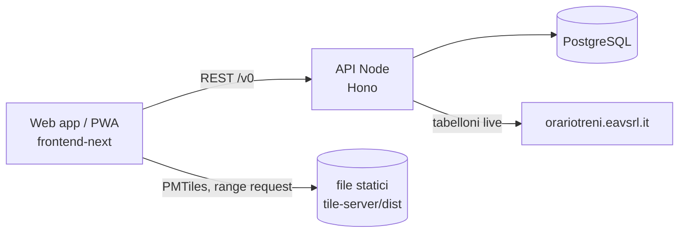
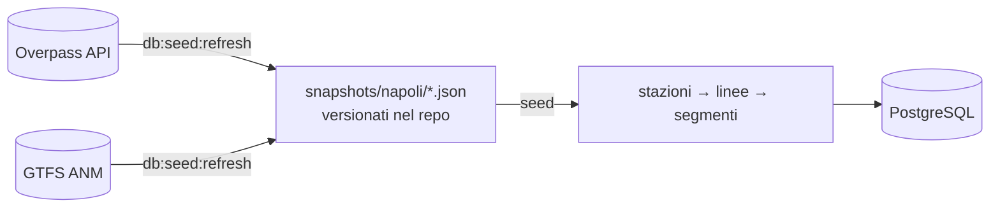

# Architettura di Statt’Accuort

Statt’Accuort è una mappa in tempo reale dei controlli dei biglietti sui mezzi pubblici della città
metropolitana di Napoli: metro, ferrovie EAV (Cumana, Circumflegrea, Circumvesuviana), funicolari e
bus ANM. Gli utenti segnalano un controllo (stazione, linea, direzione) dall'app; le segnalazioni
compaiono sulla mappa per tutti, insieme a statistiche, a una stima del rischio per tratta e ai
prossimi passaggi.

Questo documento descrive la struttura del sistema. I dettagli implementativi vivono nel codice e
nei commenti: in caso di dubbio il codice ha ragione.

## Panoramica

Lo stack è indipendente da fornitori cloud: un'API **Node.js** su **PostgreSQL**, una web app
statica e una mappa di base in file statici. Il repository è un monorepo di pacchetti indipendenti
in `packages/`, ognuno con il proprio `package.json` e `bun.lock`.



## Pacchetti

| Pacchetto | Ruolo | Runtime |
|---|---|---|
| `cities` | Registry delle città (`@stattaccuort/cities`): unica fonte dei dati specifici di città | TypeScript puro, nessuna dipendenza |
| `api-worker` | API REST, pipeline di seed (OSM + GTFS), import degli orari, migrazioni | Node.js (Hono + Drizzle) su PostgreSQL |
| `frontend-next` | Web app / PWA e app iOS (Capacitor) | React + Vite, build statica |
| `tile-server` | Costruzione della mappa di base (PMTiles) da OpenStreetMap | Script Bun + Docker (tilemaker, osmium) |

Il nome `api-worker` è storico (l'API girava su Cloudflare Workers).

### `cities` — il registry

Il codice non deve dare per scontata nessuna città. Tutto ciò che varia da città a città sta in
`packages/cities/src/<città>.ts` come **dati**: nome, sottodominio, lingua, fuso orario, centro e
limiti della mappa, estratto OSM per la basemap, operatori e linee da importare, colori per tipo di
linea, nomi leggibili delle linee, sorgenti degli orari.

Oggi esiste una sola città, `napoli` (`packages/cities/src/napoli.ts`), che è anche la città di
default. Il pacchetto viene importato direttamente dai sorgenti (alias `@stattaccuort/cities` nei
`tsconfig`/`vite`/`vitest` di ogni consumatore): nessun build, nessuna dipendenza runtime.

### `api-worker` — l'API

Server [Hono](https://hono.dev) su Node (`@hono/node-server`) con PostgreSQL tramite
[Drizzle](https://orm.drizzle.team). Entry point: `src/server.ts` (legge l'ambiente, applica le
migrazioni, ascolta sulla porta `PORT`) → `src/index.ts` (app Hono, testabile senza server).

**Risoluzione della città.** Ogni richiesta porta `?city=<slug>` (default: `napoli`). Il middleware
in `src/app-env.ts` risolve la città dal registry e costruisce i servizi per quella città. Uno slug
sconosciuto restituisce `400 UNKNOWN_CITY`. Tutte le città stanno nello stesso database.

**Moduli** (`src/modules/`):

| Modulo | Endpoint | Compito |
|---|---|---|
| `transit` | `GET /v0/transit/{stations,lines,segments,distance}` | Rete di riferimento (stazioni, linee, geometrie), ricerca del percorso tra stazioni |
| `transit` (partenze) | `GET /v0/departures/:stationId` | Prossimi passaggi: orari GTFS di ANM (tabelle `timetable_*`) e tabelloni EAV in tempo reale |
| `reports` | `GET /v0/reports`, `GET /v0/reports/:stationId`, `POST /v0/reports` | Lettura e invio delle segnalazioni, post-processing (deduzione di linea/direzione/stazione), segnalazioni "previste" quando mancano dati reali |
| `report-intake` | — | Salvataggio delle segnalazioni con limite di frequenza per dispositivo |
| `incidents` | `GET /v0/incidents`, `POST /v0/incidents` | Avvisi dei passeggeri: ritardo (con minuti stimati), disservizio, borseggiatori, su una stazione, una linea o entrambe. Tipi fissi, nessun testo libero. Restano attivi per una durata fissa per tipo (30, 120, 60 minuti); il limite di frequenza vale per dispositivo e per tipo |
| `risk` | `GET /v0/risk` | Rischio per segmento da quattro fattori: controlli (modello con decadimento spaziale e temporale), ritardi, disservizi e pericolosità (borseggiatori) dagli avvisi attivi. I fattori si combinano come OR probabilistico (`1 − Π(1 − f)`); ogni segmento riporta anche i singoli `factors`, così la mappa ricombina solo quelli scelti dall'utente |
| `insights` | `GET /v0/insights/...` | Statistiche per stazione e linea (andamento orario, punti caldi) |
| `config` | `GET /v0/config` | Configurazione della città risolta lato server (mai in cache) |
| `admin` | `GET /v0/admin/overview?window=1h\|24h\|7d\|30d` | Dati della dashboard admin: segnalazioni nel tempo, stazioni/linee/dispositivi più attivi, stato dei dati, del database e dell'istanza. Protetto da `Authorization: Bearer <ADMIN_TOKEN>`; senza token configurato risponde `503` |
| `ops` | `GET /healthz`, `/readyz`, `/metrics` | Liveness, readiness (database raggiungibile, non in chiusura) e metriche Prometheus. Fuori dal contesto della richiesta e mai esposti dal proxy pubblico |

**Antispam.** Ogni dispositivo è identificato da un'impronta anonima: HMAC-SHA256 di IP e
User-Agent con il segreto `REPORT_HASH_SECRET`, troncato a 32 caratteri. Nel database non finiscono
né l'IP né lo User-Agent. Una seconda segnalazione dallo stesso dispositivo entro
`REPORT_COOLDOWN_SECONDS` riceve `429 REPORT_RATE_LIMITED`; il controllo e l'inserimento girano in
una transazione con un advisory lock sull'impronta. Dietro un reverse proxy, `TRUST_PROXY=true` fa
leggere l'IP da `X-Forwarded-For`. L'impronta serve anche a mostrare a un utente le proprie
segnalazioni; la logica di visibilità per soglia di fiducia (`selectVisibleReports`) resta pronta,
ma oggi ogni segnalazione entra con fiducia 1 e nessuna soglia.

**Dati.** Schema in `src/db/schema/` (`stations`, `lines`, `line_stations`, `segments`, `reports`,
`incidents`, `timetable_*`, `eav_station_boards`), migrazioni Drizzle in `drizzle/`, applicate da
`bun run db:migrate` e all'avvio del server. Le tabelle di riferimento sono di sola lettura per
l'API e vengono riscritte solo dal seed; gli orari solo da `timetables:import`; `reports` e
`incidents` sono le uniche tabelle scritte dagli utenti, e il seed non cancella mai una stazione o
una linea a cui puntano. Gli avvisi stanno in una tabella separata di proposito: rischio, decadimento,
segnalazioni previste e insights leggono `reports` come "qui c'erano i controllori", e un ritardo non
deve mai colorare una tratta o pesare nella classifica dei controlli.

**Cache.** Stazioni, linee, segmenti, grafo per `/distance`, profilo orario degli insights e
tabelloni EAV sono memorizzati in ogni processo (ogni replica ha la sua copia) (`src/modules/transit/reference-cache.ts`) per
`REFERENCE_CACHE_TTL_SECONDS` (i tabelloni 30 secondi). Al browser le risposte di riferimento
arrivano con `max-age=0, must-revalidate` e ETag, così una rivalidazione costa un 304 e dopo un
nuovo seed tutti vedono subito i dati nuovi. Il resto è `no-store`.

### Pipeline dei dati (seed)

Metro, treni, Circumvesuviana e funicolari vengono da OpenStreetMap; i bus ANM dal GTFS di ANM,
perché in OSM sono mappati solo in parte (`seed.gtfsRouteTypes` nel registry). La pipeline vive in
`packages/api-worker/src/db/seed/` e ha due fasi separate:



1. **Refresh** (`bun run db:seed:refresh --city napoli`, manuale): interroga Overpass entro l'area
   amministrativa della città metropolitana (`admin_level=6`), filtra le relazioni `route` per
   operatore, tipo e ref secondo `seed` nel registry, e salva due snapshot JSON
   (`stations.json`, `route_geometries.json`). Per i tipi presi dal GTFS scarica il feed e salva
   `gtfs_network.json`: per ogni direzione di linea la sequenza di fermate seguita dalla maggior
   parte delle corse e il suo tracciato (`shapes.txt`), nello stesso formato degli elementi OSM
   (`seed/gtfs/build-network.ts`), così il resto della pipeline non cambia. Le fermate GTFS
   diventano stazioni `gtfs-<stop_id>`. `--gtfs-only` rifà solo questo snapshot. Le stazioni che
   OSM mappa ma lascia fuori dalla relazione di una linea (Baia e Pozzuoli sulla Cumana) si
   aggiungono con `seed.extraRouteStations`: il refresh scarica i nodi, il seed li inserisce dove
   allungano meno il percorso. Gli snapshot sono committati: il seed è riproducibile e non dipende
   né da Overpass né dal GTFS.
2. **Seed** (`bun run seed --city napoli`): dagli snapshot costruisce le stazioni (fondendo i nodi
   entro 250 m), le varianti di linea (una per coppia di capolinea, più la direzione di ritorno
   quando serve fermate che l'andata non tocca), i segmenti con le geometrie semplificate, e li
   scrive in modo idempotente. Non elimina mai stazioni o linee a cui fa riferimento una
   segnalazione.
3. **Orari** (`bun run timetables:import --city napoli`): collega il GTFS di ANM e l'elenco dei
   tabelloni EAV alla rete appena seedata e sostituisce le tabelle degli orari in una transazione.

Le linee di Napoli in OSM hanno ref numerici regionali (`4` = Cumana, `13` = Circumvesuviana per
Sorrento, …). Il campo `lineNames` del registry li traduce nei nomi mostrati (`Cumana`,
`CV Sorrento`); l'id della linea resta derivato dal ref.

### `frontend-next` — l'app

React 19 + Vite + TanStack Router/Query + Tailwind/shadcn, mappa con MapLibre GL. Lo stesso bundle
serve web, PWA e app iOS (Capacitor).

- **Città:** sul web è determinata dal sottodominio (`napoli.stattaccuort.it` → `napoli`); host
  sconosciuti usano la città di default. Nell'app nativa è una preferenza salvata.
- **Lingue:** italiano (lingua di ripiego) e inglese, con i18next. Ogni componente ha il suo file
  `*.i18n.ts` con i bundle `it` ed `en`.
- **Mappa:** lo stile MapLibre e le tiles arrivano da `VITE_TILES_BASE_URL`
  (`styles/<città>.json` + archivio PMTiles letto per range request); linee, stazioni e
  segnalazioni sono livelli disegnati sopra con i dati dell'API. La vista predefinita colora le
  linee per tipo; un filtro sceglie quali tipi mostrare.
- Contiene ancora la configurazione per servirla da un Worker Cloudflare (`wrangler.jsonc`,
  `worker/`), non usata: in locale la serve Vite, in produzione basterà un server statico.

### `tile-server` — la mappa di base

Non è un server: `scripts/generate.ts` scarica l'estratto Geofabrik indicato in `tiles.osmUrl`
(per Napoli il Sud Italia), lo ritaglia con osmium sui `map.bounds` della città, genera le tiles
con tilemaker (entrambi in Docker) e produce `dist/<città>.pmtiles` e `dist/styles/<città>.json`.
Li serve qualunque server statico che supporti le richieste Range e CORS; in locale
`styles/serve.ts`.

## Osservabilità

- **Log:** logger strutturato (`packages/api-worker/src/common/logger.ts`) su stdout.
- **Metriche:** `src/common/metrics.ts` (prom-client) espone su `/metrics` le metriche di processo
  di Node (CPU, memoria, event loop, GC), le richieste HTTP per pattern di route (contatore e
  istogramma di latenza), le segnalazioni create o bloccate dal limite e gli hit/miss della cache di
  riferimento. Ogni serie porta l'etichetta `instance_id` della replica. Prometheus (profilo
  `monitoring` del compose, `docker/prometheus/`) le raccoglie da tutte le repliche e valuta alcune
  regole di allerta.
- **Salute:** `/healthz` (il processo risponde) e `/readyz` (il database risponde e la replica non
  è in chiusura) per orchestratori e load balancer.
- **Dashboard admin:** la pagina `/admin` del frontend (non collegata dall'app, caricata a parte)
  chiede l'`ADMIN_TOKEN` e mostra `GET /v0/admin/overview`. I numeri dell'istanza sono della replica
  che ha risposto; quelli aggregati su tutte le repliche stanno in Prometheus.
- **Errori:** `reportError` in `src/app-env.ts` è un punto d'innesto per un servizio come Sentry,
  oggi non collegato.

## Scalabilità orizzontale

L'API è senza stato: tutto ciò che deve essere condiviso sta in PostgreSQL, quindi si scala
aggiungendo repliche dietro Caddy.

- **Limite di frequenza:** controllo e inserimento avvengono in una transazione con un advisory
  lock sull'impronta del dispositivo, quindi valgono tra repliche diverse.
- **Migrazioni:** ogni replica le applica all'avvio sotto un advisory lock di sessione
  (`applyMigrationsExclusively`): partendo insieme, una migra e le altre aspettano.
- **Cache:** per processo e con TTL. Dopo un seed le repliche possono vedere dati diversi per al
  massimo `REFERENCE_CACHE_TTL_SECONDS`; i tabelloni EAV vengono scaricati da ogni replica.
- **Connessioni:** ogni replica apre fino a `DATABASE_POOL_MAX` connessioni; repliche × pool deve
  restare sotto `max_connections` di Postgres (100 di default), con margine per seed e import.
- **Spegnimento:** su `SIGTERM` `/readyz` passa a `503`, il server smette di accettare connessioni
  dopo `SHUTDOWN_DRAIN_SECONDS`, completa le richieste in corso e chiude il pool.
- **Bilanciamento:** Caddy risolve `api` via DNS di Docker (un indirizzo per replica) e distribuisce
  con `least_conn`; una replica che rifiuta le connessioni viene esclusa per qualche secondo e la
  richiesta ritentata su un'altra.

Il collo di bottiglia successivo è il database: prima delle repliche di lettura conviene guardare
le query lente (`pg_stat_statements`) e la latenza per route in Prometheus.

## Esecuzione

In produzione (e per provarla in locale) lo stack gira con `docker compose` nella radice del repo:
PostgreSQL, l'API e un Caddy che serve frontend e tile e inoltra `/api` all'API. I dettagli sono in
[deploy.md](./deploy.md).

## Sviluppo locale

```sh
# Database (PostgreSQL in Docker) e API (porta 8787)
cd packages/api-worker
bun install
cp .env.example .env          # imposta REPORT_HASH_SECRET
bun run db:up
bun run seed --city napoli
bun run timetables:import --city napoli
bun run dev

# Frontend (porta 1871)
cd packages/frontend-next
bun install
cp .env.example .env          # VITE_API_URL=http://localhost:8787
bun run dev                   # apri http://napoli.localhost:1871
```

Per la mappa di base in locale: `CITY=napoli bun run generate` in `packages/tile-server`, poi
`bun styles/serve.ts dist 3001` e `VITE_TILES_BASE_URL=http://localhost:3001` nel `.env` del
frontend.

## Aggiungere una città

1. Crea `packages/cities/src/<città>.ts` sul modello di `napoli.ts` e registrala in
   `packages/cities/src/index.ts`.
2. `bun run db:seed:refresh --city <città>` e controlla nei log le linee trovate; affina
   `operators`, `routeRefPatterns` e `lineNames` finché il risultato è quello atteso.
3. `bun run seed --city <città>` (e `timetables:import` se ha orari), poi aggiungi il suo dominio
   alle `CORS_ORIGINS` dell'API.
