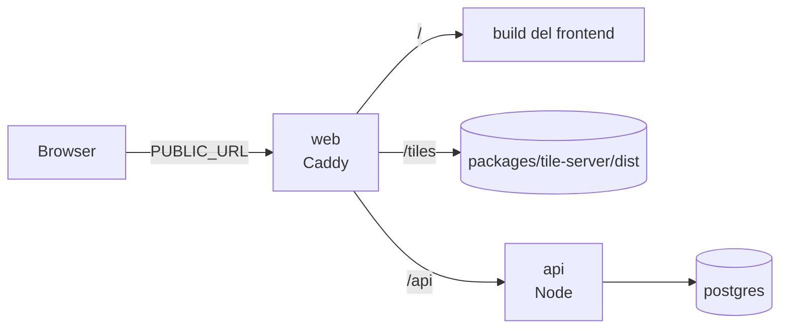

# Esecuzione e operazioni di Statt’Accuort

Lo stack si avvia in due modi: tutto in **Docker** (`compose.yaml` nella radice del repo, lo stesso
che servirà sul VPS) oppure in **sviluppo**, con i singoli server in locale.

Per la struttura dei componenti vedi [architecture.md](./architecture.md).

## Docker



Tre servizi su un'unica origine, quindi senza problemi di CORS:

| Servizio | Immagine | Ruolo |
|---|---|---|
| `postgres` | `postgres:18` | Database, volume `postgres_data`, non esposto all'host |
| `api` | `packages/api-worker/Dockerfile` | API Node, `API_REPLICAS` repliche; con un argomento esegue un job (`setup`, `seed`, `timetables`, `migrate`) |
| `web` | `docker/web/Dockerfile` | Caddy: build del frontend su `/`, tile su `/tiles`, proxy bilanciato sulle repliche dell'API su `/api` |
| `prometheus` | `prom/prometheus` | Solo con `--profile monitoring`: metriche di tutte le repliche, UI su `127.0.0.1:9090` |

```sh
cp .env.example .env          # PUBLIC_URL, POSTGRES_PASSWORD, REPORT_HASH_SECRET
docker compose up -d --build postgres
docker compose run --rm api setup     # seed + orari; da rifare dopo ogni aggiornamento dei dati
docker compose up -d --build          # l'app è su PUBLIC_URL (default http://localhost:8080)
```

- `PUBLIC_URL` è l'indirizzo da cui i browser raggiungono l'app. Finisce dentro la build del
  frontend, quindi dopo averlo cambiato serve `docker compose up -d --build web`. Per provare dal
  telefono usa l'IP del computer nella LAN (`http://192.168.x.y:8080`).
- La mappa di base non è nell'immagine: `web` monta `packages/tile-server/dist` in sola lettura,
  quindi va generata prima (`CITY=napoli bun run generate` in `packages/tile-server`). All'avvio
  `docker/web/start.sh` riscrive l'URL dell'archivio negli stili con `PUBLIC_URL`.
- L'API applica le migrazioni all'avvio e gira con `NODE_ENV=production` e `TRUST_PROXY=true`
  (l'IP del client arriva da Caddy in `X-Forwarded-For`).
- Il database del compose è separato da quello di sviluppo di `packages/api-worker/compose.yaml`.
- Caddy risponde `404` a `/api/metrics`, `/api/healthz` e `/api/readyz`: questi endpoint si
  raggiungono solo dalla rete interna del compose.

### Scalare l'API

```sh
API_REPLICAS=3 docker compose up -d            # oppure: docker compose up -d --scale api=3
```

Caddy trova le nuove repliche da solo (DNS di Docker, aggiornato ogni 5 secondi). Tieni
`API_REPLICAS × DATABASE_POOL_MAX` sotto `max_connections` di Postgres (100). Un aggiornamento
(`docker compose up -d --build`) ricrea le repliche; le richieste che trovano una replica in
chiusura vengono ritentate su un'altra.

### Monitoraggio

```sh
docker compose --profile monitoring up -d      # Prometheus su 127.0.0.1:9090 (tunnel SSH sul VPS)
```

Le regole in `docker/prometheus/alerts.yml` (replica giù, errori 5xx, latenza p95, event loop
bloccato, picco di segnalazioni rifiutate) compaiono in *Alerts*. Per ricevere notifiche aggiungi
Alertmanager o collega Grafana a questo Prometheus.

### Dashboard admin

Imposta `ADMIN_TOKEN` nel `.env` (`openssl rand -hex 32`), riavvia `api` e apri `PUBLIC_URL/admin`.
Senza token l'API admin risponde `503`. Il token resta nella `sessionStorage` della scheda;
per revocarlo cambialo e riavvia l'API.

## Sviluppo

```sh
# 1. Database
cd packages/api-worker
bun install
cp .env.example .env                    # poi imposta REPORT_HASH_SECRET (vedi sotto)
bun run db:up                           # PostgreSQL 18 su 127.0.0.1:5432 (compose.yaml)

# 2. Dati
bun run seed --city napoli              # migrazioni + stazioni, linee, segmenti
bun run timetables:import --city napoli # orari GTFS ANM + tabelloni EAV

# 3. API → http://localhost:8787
bun run dev

# 4. Mappa di base → http://localhost:3001 (la prima volta: CITY=napoli bun run generate)
cd ../tile-server && bun styles/serve.ts dist 3001

# 5. Frontend → http://localhost:1871
cd ../frontend-next && bun run dev
```

`compose.yaml` crea due database: `stattaccuort` (sviluppo) e `stattaccuort_test` (test). I dati
restano nel volume Docker `postgres_data`.

## Configurazione dell'API (`packages/api-worker/.env`)

Tutte le variabili sono documentate in `.env.example`.

| Variabile | Note |
|---|---|
| `DATABASE_URL` | Connessione PostgreSQL |
| `PORT`, `HOST` | Default `8787` e `0.0.0.0` (raggiungibile dalla LAN, utile per il telefono) |
| `CORS_ORIGINS` | Origini ammesse per le richieste in scrittura; le origini di rete privata sono sempre ammesse |
| `REPORT_HASH_SECRET` | Segreto dell'impronta anonima dei dispositivi. **Obbligatorio con `NODE_ENV=production`**; generane uno con `openssl rand -hex 32`. Cambiarlo azzera i limiti di frequenza |
| `REPORT_COOLDOWN_SECONDS` | Intervallo minimo tra due segnalazioni dello stesso dispositivo (default 600; l'app ne impone già 900 lato client) |
| `TRUST_PROXY` | `true` dietro un reverse proxy, per leggere l'IP da `X-Forwarded-For` |
| `REFERENCE_CACHE_TTL_SECONDS` | Durata della cache in memoria di stazioni, linee e segmenti |
| `ADMIN_TOKEN` | Bearer token della dashboard admin (`/v0/admin`), almeno 32 caratteri. Vuoto: admin disattivato |
| `DATABASE_POOL_MAX` | Connessioni al database per processo (default 10) |
| `SHUTDOWN_DRAIN_SECONDS` | Secondi in cui la replica continua a servire con `/readyz` a 503 prima di chiudere (default 0; serve con load balancer che interrogano `/readyz`, come Kubernetes) |
| `INSTANCE_ID` | Nome della replica nelle metriche e nella dashboard (default: hostname, cioè l'id del container) |

Il frontend legge `VITE_API_URL` e `VITE_TILES_BASE_URL` da `packages/frontend-next/.env`. Le
variabili `VITE_*` finiscono nel bundle pubblico: non metterci segreti.

## Aggiornare i dati

**Rete (linee e stazioni).** Il seed usa gli snapshot committati in
`packages/api-worker/src/db/seed/snapshots/`, non Overpass né il GTFS.

- `bun run db:seed:refresh --city napoli` rifà tutti gli snapshot. Interroga Overpass, quindi può
  richiedere da pochi minuti a qualche decina se i server sono carichi.
- `bun run db:seed:refresh --city napoli --gtfs-only` rifà solo le linee bus dal GTFS di ANM, in
  pochi secondi: da lanciare quando ANM pubblica un nuovo feed (l'attuale vale fino al 31/12/2026).
- Poi `bun run seed --city napoli` e `bun run timetables:import --city napoli`. Il server in
  esecuzione vede i nuovi dati entro `REFERENCE_CACHE_TTL_SECONDS`, o subito se lo riavvii.

**Orari dei passaggi.** `bun run timetables:import --city napoli` scarica il GTFS di ANM e l'elenco
dei tabelloni EAV, li collega alla rete seedata e sostituisce le tabelle in una transazione. Va
rilanciato dopo ogni seed che cambia linee o stazioni. Nel log elenca le route e i tabelloni senza
corrispondenza: un tabellone EAV con un nome diverso dal nostro si aggiunge a
`timetables.eavStationAliases` in `packages/cities/src/napoli.ts`. Le partenze EAV in tempo reale
sono lette dal sito orariotreni.eavsrl.it a ogni richiesta (con 30 secondi di cache): non è un'API
documentata, quindi se EAV cambia la pagina il pannello mostra solo gli orari ANM.

**Schema del database.** Modifica `src/db/schema/`, poi `bun run db:generate` e dai alla
migrazione un nome descrittivo (vedi AGENTS.md). Le migrazioni si applicano con
`bun run db:migrate`, e comunque all'avvio del server e del seed.

## Test e CI

`bun run test` in `packages/api-worker` richiede il Postgres locale: ricrea `stattaccuort_test`,
applica le migrazioni e fa il seed una volta per esecuzione. In GitHub Actions restano solo i
workflow di CI (`api-worker-ci.yml` con un servizio Postgres, `frontend-next-ci.yml`,
`tile-server-ci.yml`); i vecchi deploy verso Cloudflare sono stati rimossi.

## Prima della messa online

- [ ] **Dominio e server**: un VPS con Docker, il dominio (oggi i file usano `stattaccuort.it`:
      `publicAppUrl` e `map.styleUrl` nel registry, `VITE_API_URL` in `.env.production`).
- [ ] **HTTPS**: sul VPS Caddy può ottenere il certificato da solo se nel `Caddyfile` si sostituisce
      `:80` con il dominio e si espongono le porte 80 e 443; `PUBLIC_URL` diventa `https://<dominio>`.
- [ ] **Segreti**: `REPORT_HASH_SECRET` di produzione, password di PostgreSQL non di default.
- [ ] **Backup** del database (almeno `reports`; il resto si ricostruisce dal seed).
- [ ] **Pagine legali**: titolare del trattamento, note legali e informativa privacy in
      `packages/frontend-next/src/components/legal/` descrivono ancora FreiFahren e.V. e i servizi
      Cloudflare, Sentry e PostHog.
- [ ] **Antispam**: oggi c'è solo il limite per dispositivo. Valuta un captcha prima di aprire il
      servizio al pubblico.
